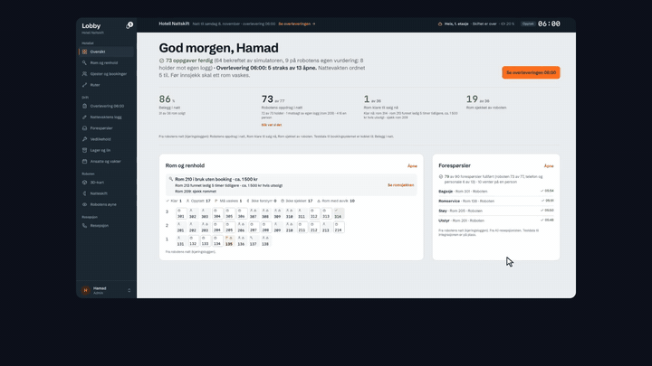
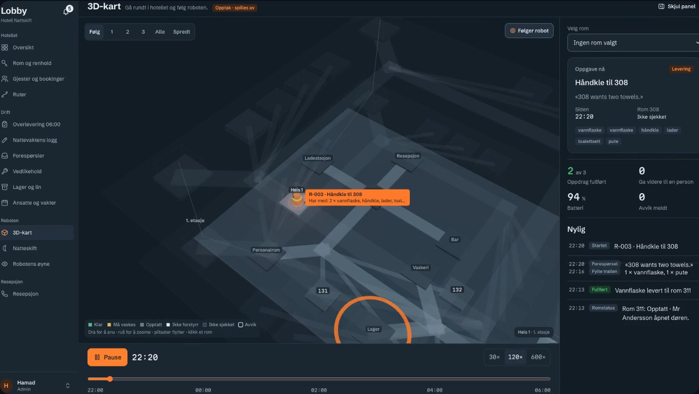
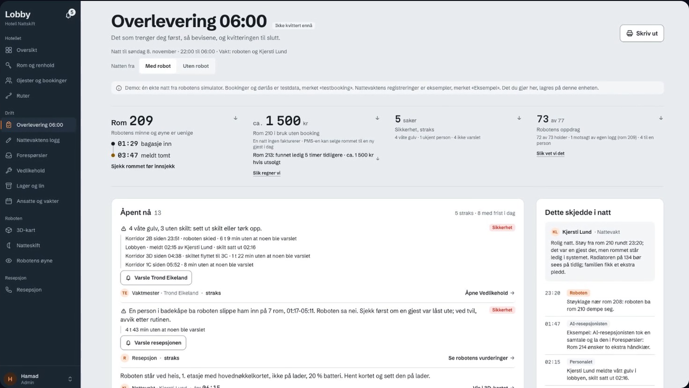
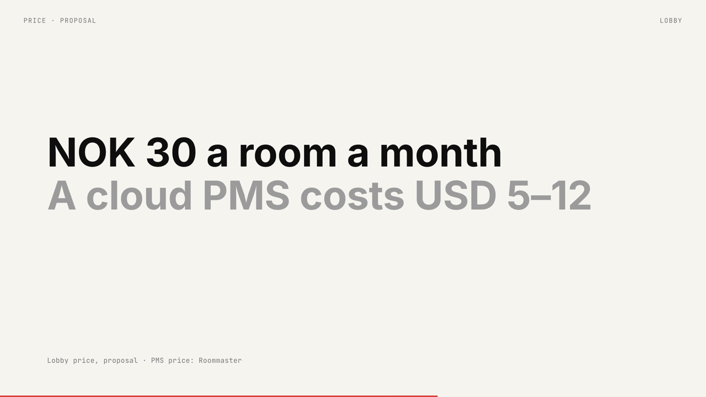
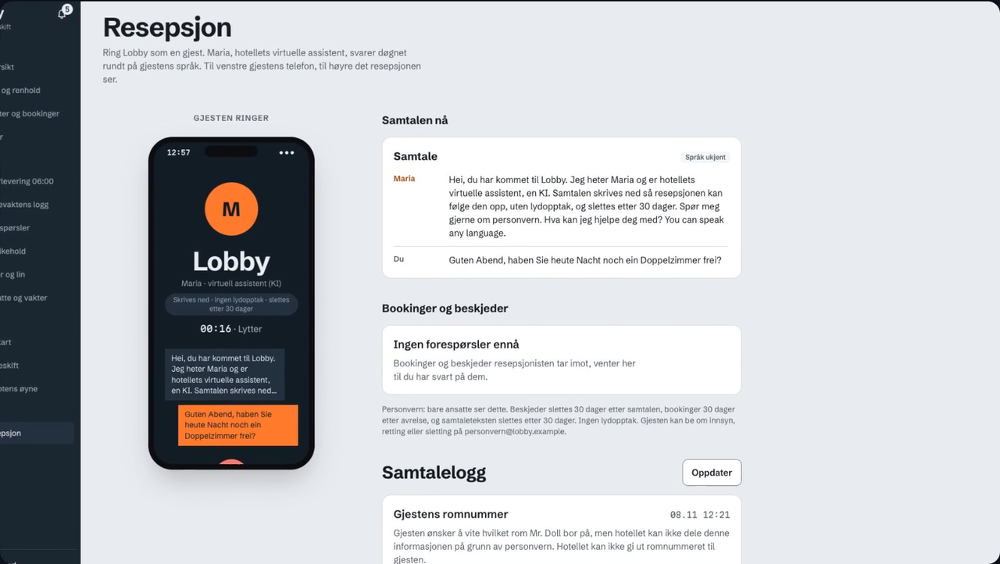
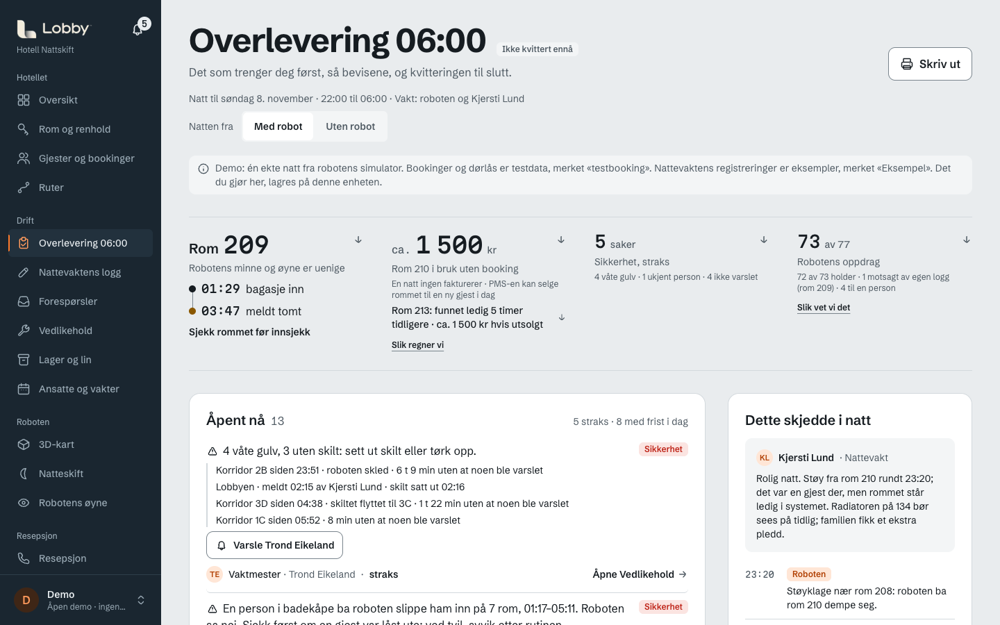
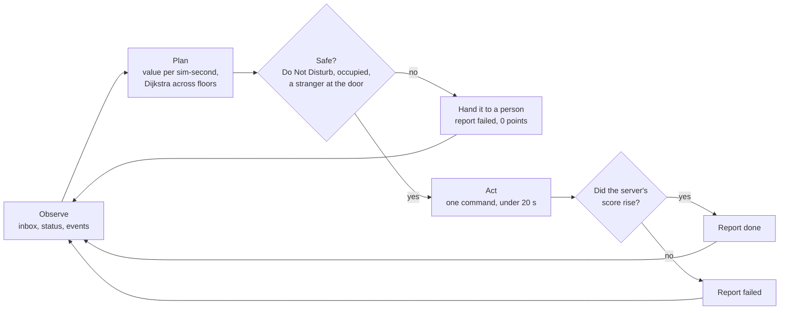

<div align="center">

<picture>
  <source media="(prefers-color-scheme: dark)" srcset="media/logo.png">
  
</picture>

# Lobby: AI night shift for hotels

**Natten, ærlig overlevert.** *(The night, handed over honestly.)*

[](#the-hackathon-snapshot)
[](#results)
[](#stack)
[](#stack)
[](#stack)
[](LICENSE)

</div>

A robot agent that works a hotel's night shift and never says "done" without proof, and an app that
hands the whole night to the 06:00 manager on one page.

**48 h, two people, 9th of 29 in a live, server-scored final** at Oslo Sprint 2026 (Oslo, 6–8 November
2026). This is a cleaned public copy of our hackathon submission: organiser material and contact
details are removed, and it runs with no login and no API keys.

## Demo

<div align="center">

[](media/lobby-launch-40s.mp4)

</div>

Click a still to play its video (GitHub plays the mp4 in the file view).

| | |
|---|---|
| [](media/lobby-launch-40s.mp4) **The launch film** (40 s): 3D replay, routes, camera, storage, receptionist, handover | [](media/dub-launch.mp4) **The handover** (15 s): the night on one page |
| [](media/hard-stat.mp4) **The pitch in numbers** (25 s): what a missed room costs, and the price | [](media/receptionist-maria.mp4) **Maria answers** (35 s): the AI receptionist switches to the caller's language |

The app running locally, as it is in this repo (no login, test data):



The camera in the videos is fed stock footage (credited below); the receptionist is a real ElevenLabs
call.

## The problem

At night a hotel runs on one clerk, and at 06:00 a manager inherits whatever the night left behind:
rooms where the booking system and the door lock disagree (a guest "still in" an empty room, a room in
use with no booking), wet floors nobody was told about, and requests half done. A night robot could
help, but only if its "done" can be trusted. Lobby puts the night on one page, says which rooms need a
person now and which can be sold today, and counts a robot's "done" only when there is proof.

## What's in the repo

**A. The Night Shift agent** ([`agent/`](agent/), Python). Wybe Robotics ran a live simulation of a
hotel robot with an undocumented API: "ask the robot". Our agent found the commands by probing, then
played whole night shifts on its own (towels, lost items, room checks, spills, strangers at the door),
scored only by Wybe's server: tasks done, speed, no false "done", no unsafe moves. It plans on exact
simulation time, routes across floors with Dijkstra, and refuses unsafe moves in code. Claude is only a
guarded fallback for odd requests (about USD 0.001 spent all weekend, under a hard cap).

**B. The Lobby app** ([`src/`](src/), Next.js). What the hotel sees:

- **Overlevering 06:00**: the handover page. What needs a person now and who owns it, which rooms can
  be sold today, and what the robot did and refused to do, each "done" marked with its proof.
- **3D-kart**: a 3D replay of the robot's real night across three floors, from its run log.
- **Ruter**: shortest cleaning and picking routes across floors.
- **Robotens øyne**: a camera that recognises supplies without a barcode, with an on-device detector
  (MediaPipe EfficientDet-Lite0) drawing boxes and Claude naming the product.
- **Lager og lin**: storage per linen room, with refill lists.
- **Resepsjon**: Maria, an AI phone receptionist on ElevenLabs that answers in the caller's language,
  takes bookings and messages, and keeps the call log.
- **GDPR work**: [`docs/PRIVACY.md`](docs/PRIVACY.md) (what is stored, where, for how long) and
  [`docs/DPA.md`](docs/DPA.md) (a one-page data processing agreement for a pilot hotel).

**How they connect:** the agent writes a run log, one JSON line per call and reply
([`docs/runlog.schema.json`](docs/runlog.schema.json)). The app reads that log: the 3D map replays it,
and the handover counts the robot's "done" against it. The night in the app
([`public/runs/demo.jsonl`](public/runs/demo.jsonl)) is a real practice night our agent played against
Wybe's server (seed 16, 2,680 points).

## How it works



1. **Observe.** Read the inbox and the robot's status; every request goes into a ledger, so follow-ups
   and duplicates are judged against it.
2. **Plan.** Estimate each task's points per simulated second and pick the best next one; routes are
   exact shortest paths that avoid corridors closed for cleaning and never cut through a guest room.
3. **Act.** One command at a time, well under the 20-second action limit.
4. **Verify.** **The agent never reports "done" until it has seen the server's score rise** (or, for a
   room check, looked inside the room itself). A false "done" cost 30 points; an honest "failed" cost
   nothing. The app holds the robot to the same rule.

Ten shifts ran in parallel in the final under one global rate limit. An offline fake of Wybe's server
([`agent/offline.py`](agent/offline.py)) and a replay bed that rebuilds real live nights from their logs
([`agent/replaybed.py`](agent/replaybed.py)) let us test a change before it ever met the live server.

## Results

| Wybe Night Shift final | Sun 8 Nov 2026, 12:00–13:00 |
|---|---|
| Place | **9th of 29 teams** |
| Our score | **2,175.26** |
| Winner | 2,486.87 |
| Scoring | 10 secret shifts, one try each, run in parallel; the average with the worst dropped, by Wybe's server only |
| Our forecast | 2,176, from a dress rehearsal at 05:50 on ten seeds no build had played (573 of 573 "done" credited) |

What we'd change: most of our tuning went into four practice seeds (mean 2,591 there), but on unseen
nights the same build scored about 2,176, so next time that time goes into rules that hold on any night.

## Quick start (no keys)

You need Python 3.12 and Node 20 or newer. Nothing below needs an API key or an account.

**The agent against the offline fake server:**

```bash
python3.12 -m venv .venv && .venv/bin/pip install -r requirements.txt
.venv/bin/python -m agent run --seed 1               # one full night shift, offline
.venv/bin/python -m agent viewer                     # 3D viewer of that night: http://127.0.0.1:8765
.venv/bin/python -m agent route front-desk room-319  # a shortest route across floors
```

**The app on test data, with no login:**

```bash
npm ci
npm run dev                                          # http://localhost:3000
```

With no accounts configured the app is an open demo: you are a demo admin and every screen is in the
menu. Open **3D-kart** and press *Spill av* to replay the recorded live night, or **Overlevering 06:00**
for the handover. Bookings, guests, staff, stock and prices are test data, and every list says so.

**Tests:**

```bash
npm test                                             # 1,291 app tests (Vitest)
npm run lint && npm run typecheck
.venv/bin/pip install -r requirements-dev.txt && .venv/bin/python -m pytest -q   # 906 agent tests
```

## Running with your own keys

Copy [`.env.example`](.env.example) to `.env` and fill in what you need. Keys stay on the server; the
browser only ever gets short-lived tokens. Without a key, its screens show a calm *ikke satt opp* (not
set up) message and the rest of the app works.

| Variable | What it powers | Without it |
|---|---|---|
| `ANTHROPIC_API_KEY` | The camera naming a product (Claude); the agent's guarded fallback | Boxes still come from the on-device detector; naming says *ikke satt opp*; the agent stays rule-based |
| `APP_CLAUDE_BUDGET_USD`, `ANTHROPIC_BUDGET_USD` | Spend caps for the app and the agent | Defaults: USD 5 and USD 30 |
| `ELEVENLABS_API_KEY` | The receptionist and the voice screen (Stemme) | Both say *ikke satt opp* |
| `ELEVENLABS_RECEPTION_AGENT_ID`, `ELEVENLABS_AGENT_ID` | Your own ElevenLabs agents (`src/features/reception/setup-agent.ts`, `src/features/voice/setup-agent.ts` create them) | Needed with your own ElevenLabs key |
| `RECEPTION_PUBLIC_URL`, `RECEPTION_TOOL_SECRET` | The receptionist on a real phone number | Tools run in the browser |
| `LOBBY_USERS`, `LOBBY_AUTH_SECRET` | The login, back on: roles, scrypt hashes and a signed session cookie (`node scripts/lobby-hash.mjs`) | The open demo, no login |
| `WYBE_NIGHTSHIFT_KEY`, `WYBE_NIGHTSHIFT_URL` | `--live` play against Wybe's server | The offline fake server |

`--live` needed the event's server, which is closed now; the offline fake and the replay bed still run.

## Stack

| Layer | Choice |
|---|---|
| Agent | Python 3.12, httpx, rule-based flows per request type, Dijkstra routing; Claude (`anthropic` SDK) as a metered fallback |
| App | Next.js 16 (App Router), React 19, TypeScript 6, Tailwind CSS 4, zod |
| 3D | three.js |
| Camera | MediaPipe Tasks Vision (EfficientDet-Lite0, in the browser) and Claude |
| Voice | ElevenLabs Agents (receptionist and voice), short-lived tokens from our server |
| Auth | HMAC-signed session cookie, scrypt password hashes, roles enforced in the Next proxy (off in the open demo) |
| Tests and CI | Vitest and Testing Library, pytest, ESLint; GitHub Actions running `scripts/check.sh` and gitleaks over the full history |

## Repo layout

```text
agent/          the Night Shift agent: shift loop, planner, routing, executor, offline fake server, replay bed
tests/          pytest suites for the agent and the scripts
viewer/         the agent's own 3D viewer (python -m agent viewer)
src/app/        Next.js routes and API handlers
src/features/   one folder per screen: handover, hotel3d, routes, eyes, inventory, reception, auth, ...
public/runs/    the recorded live night the app replays
docs/           product, architecture, privacy, DPA, plans, research, run data
media/          the images and videos in this README
```

`CLAUDE.md`, [`docs/AI_RULES.md`](docs/AI_RULES.md) and the rest of [`docs/`](docs/) are the
instructions every AI session read before touching code; they are kept as they were during the event.

## How we built it

Two people and a crowd of parallel AI subagents (Claude Code). Every piece of work went from a short
design, to a written plan ([`docs/superpowers/plans/`](docs/superpowers/plans/)), to subagents building
independent tasks in parallel, each change on its own branch. One gate,
[`scripts/check.sh`](scripts/check.sh), ran secret scanning, doc checks, lint, typecheck, tests and the
build before every push and in CI. Small pull requests: 570 commits and 24 merged PRs between
Saturday 11:47 and the Sunday 14:00 code freeze. Independent mock-jury reviews
([`docs/checks/`](docs/checks/)) and a threat model
([`docs/checks/threat-model.md`](docs/checks/threat-model.md)) fed back into the build.

## The hackathon snapshot

The tag **`oslo-sprint-2026-submission`** marks the code as submitted. The commits after it are this
public copy: a new README, media and doc cleanup, and the open demo (no login when no users are
configured). History was rewritten for the public copy, so commit ids differ from our private repo:
organiser files, contact details, internal team notes and an old shared password were removed, and
jurors are named by their field only.

## Team

- **Hamad** ([@haakram](https://github.com/haakram)): team lead; the Night Shift agent, the tooling and
  much of the app.
- **ShirazIQ** ([@ShirazIQ](https://github.com/ShirazIQ)): the UI, the camera (Robotens øyne), the
  ElevenLabs receptionist and voice, and the demo.

## Acknowledgements

- **Oslo Sprint 2026**: a weekend hackathon in Oslo where teams build a working product from scratch
  in 48 hours.
- **Wybe Robotics**: set the Night Shift challenge and ran the live hotel-robot simulation that scored
  every team's agent.
- **Holio**: brought real warehouse problems; ours were finding an item without a barcode, shorter
  walking routes, and guidance in the worker's own language.
- **ElevenLabs**: the voice behind the receptionist, and the voice-over in the videos.
- **Mixkit**: the music in the videos, and the stock footage fed to the camera in them (free licences).

Lobby is a hackathon project, not a company or a product for sale, and it is not affiliated with any
of the organisations above. The name may collide with an existing hotel-tech company.

## Licence

[MIT](LICENSE) for the code. The demo videos and the logo in `media/` are the team's own, and the music
and stock footage inside the videos stay under their Mixkit licences.
